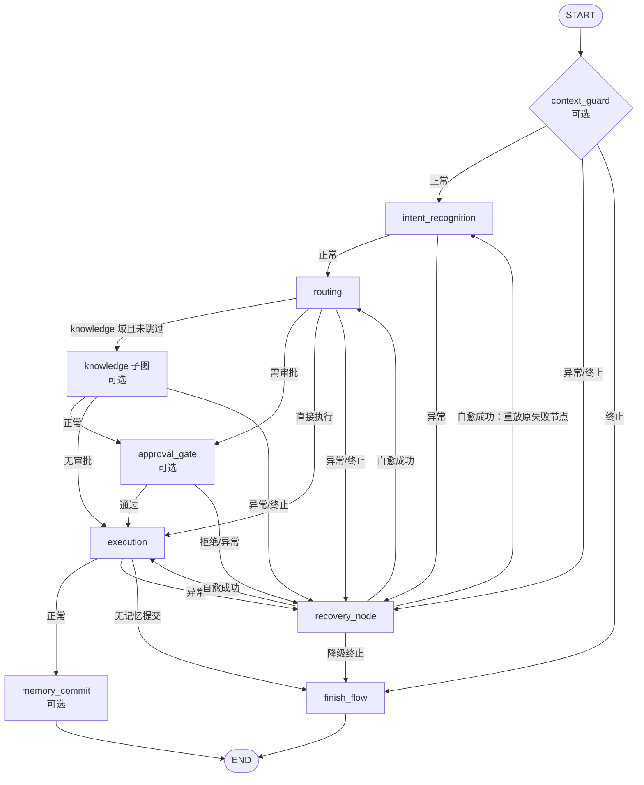

# LangGraph 智能体系统 · 项目说明文档

> 一个基于 **LangGraph** 构建的生产级智能体（Agent）运行时系统。采用"意图识别 → 路由调度 → 知识/执行 → 异常自愈 → 收尾"的主控状态图编排，通过 **协议层（Protocols）实现依赖倒置**，将模型适配、意图识别、路由、Agent 插件、恢复策略、知识库等能力全部做成可插拔组件。

---

## 一、项目简介

本项目是一个面向企业场景的对话式 Agent 服务，核心目标是把"不确定的大模型调用"封装成"确定、可观测、可自愈"的工程化流水线。它以 FastAPI 对外提供 HTTP 网关，以 LangGraph `StateGraph` 作为内部编排引擎。

主要解决的问题：

- **意图与执行解耦**：先用轻量规则 + 大模型完成意图识别，再根据路由目录确定性分发到具体执行器。
- **复杂任务拆解**：内置 Plan-and-Solve 编排器，将复杂目标拆成带 DAG 依赖的原子步骤并发执行，失败可动态重规划。
- **结构化输出容错**：大模型输出 JSON 被污染（思维链、Markdown、截断）时，提供两级自愈（本地清洗 + 大模型重写）。
- **领域知识闭环**：内置 LLM-WIKI 风格的知识库子图，支持"检索 → 求解 → 缺口 → 采集 → 组织 → 落盘"的迭代闭环。
- **生产级可观测性**：全链路 `trace_id`、脱敏日志、耗时统计、统一错误码与兜底话术。

---

## 二、核心特性

| 特性 | 说明 |
| --- | --- |
| 主控状态图 | LangGraph `StateGraph` 编排，节点间通过 `MasterAgentState` 增量传递 |
| 混合意图识别 | 静态指令 `command_map` → 正则 `fast_rules` → 大模型语义分类三级漏斗 |
| 确定性路由 | 基于 `route_catalog.json` 的目录化路由，含低置信度/未命中降级 |
| 插件化 Agent | 装饰器自动扫描注册，运行时实例池解析，启动期路由完整性 Fail-Fast |
| 复杂任务规划 | LLM 生成 DAG 计划，按依赖分层并发执行，支持 Replan |
| 异常自愈 | 统一 `FailureContext` 标准化，责任链恢复，JSON 两级修复 |
| 知识库子图 | 黑盒节点接入，内部四环节闭环，对主图零侵入 |
| 依赖倒置 | 全系统跨模块依赖均通过 `protocols` 包中的 `Protocol` 抽象 |
| 数据契约 | Pydantic 不可变 Schema，支持从模型自省生成 Prompt 说明 |
| 网关容错 | 非法 JSON 反斜杠自动修复、超时/校验/未知异常统一处理 |
| 可观测性 | `contextvars` 全链路追踪、日志脱敏、执行耗时装饰器 |

---

## 三、技术栈

- **运行时**：Python 3.12（仓库 `.venv` 为 CPython 3.12）
- **Web 框架**：FastAPI + Uvicorn
- **编排引擎**：LangGraph（`StateGraph` / `CompiledStateGraph` / `MemorySaver` / `interrupt`）
- **模型接入**：LangChain（`langchain-core`、`langchain-openai`、`ChatOpenAI`）
- **数据校验**：Pydantic v2 + pydantic-settings
- **其他**：httpx、python-dotenv、tiktoken、sentence-transformers、numpy

依赖清单见 `requirements.txt`。

---

## 四、目录结构

```text
Langgraph/
├── main.py                     # 生产启动入口：读取配置并拉起 Uvicorn
├── bootstrap.py                # 对外导出 AgentApplication
├── requirements.txt            # 依赖清单
├── persistence.md              # 关于 LangGraph 持久化的研究笔记（独立文档）
│
├── api/                        # 接入层（HTTP 网关）
│   ├── server.py               # FastAPI 应用工厂、健康检查、聊天接口
│   └── middlewares.py          # JSON 容错中间件、可观测中间件、全局异常处理器
│
├── app/                        # 应用装配层
│   ├── application.py          # AgentApplication 运行时门面（同步/异步调用入口）
│   ├── container.py            # 唯一依赖接线中心：组装主控图与所有组件
│   └── llm_factory.py          # 按角色构建多模型适配器池
│
├── config/                     # 配置层
│   ├── system_config.py        # 系统/模型/服务器/知识库配置模型
│   ├── business_config.py      # 业务目录（意图 + 路由）加载与一致性校验
│   ├── agent_settings.json     # 系统配置（服务器、模型池、知识库开关）
│   ├── intent_catalog.json     # 意图目录（静态指令、正则规则、语义意图）
│   └── route_catalog.json      # 路由目录（意图 → 处理域/节点）
│
├── graphs/                     # 编排层（LangGraph 状态图）
│   ├── state.py                # MasterAgentState 全局状态定义
│   ├── master_graph.py         # 主控图构建器（拓扑 + 条件边 + 风险防护）
│   ├── intent_graph.py         # 意图识别节点工厂
│   ├── routing_graph.py        # 路由调度节点工厂
│   ├── knowledge_graph.py      # 知识领域子图（fast_retrieve / deep_learn）
│   ├── execution_graph.py      # 执行节点工厂
│   ├── recovery_graph.py       # 自愈节点工厂
│   ├── persistence_graph.py    # 上下文守卫 / 记忆提交节点工厂
│   └── governance_graph.py     # 人工审批门禁节点工厂（interrupt）
│
├── components/                 # 能力实现层（可插拔）
│   ├── agents/                 # 业务执行器（插件注册 + 运行时实例池）
│   ├── intent/                 # 混合意图识别器
│   ├── routing/                # 目录化路由调度器
│   ├── planning/               # LLM 任务规划器（DAG）
│   ├── recovery/               # 异常恢复责任链与 JSON 自愈
│   ├── internal_knowledge/     # 领域知识库闭环引擎
│   └── _shared/                # 通用评估器、异常映射、输入清洗
│
├── protocols/                  # 协议层（依赖倒置的核心契约）
├── schemas/                    # 数据契约层（Pydantic 不可变模型）
├── infra/                      # 基础设施（模型适配、日志观测、异常）
│
└── persistence-instances/      # 独立的持久化/上下文治理实验子项目
```

---

## 五、整体架构

### 5.1 分层架构

```text
┌──────────────────────────────────────────────────────────────┐
│  接入层 api/            FastAPI 网关、中间件、异常处理           │
├──────────────────────────────────────────────────────────────┤
│  装配层 app/            AgentApplication 门面 + 依赖接线中心     │
├──────────────────────────────────────────────────────────────┤
│  编排层 graphs/         LangGraph 主控状态图与各节点工厂          │
├──────────────────────────────────────────────────────────────┤
│  能力层 components/     意图/路由/Agent/规划/恢复/知识库          │
├──────────────────────────────────────────────────────────────┤
│  协议层 protocols/      Protocol 契约（跨模块唯一依赖入口）        │
├──────────────────────────────────────────────────────────────┤
│  契约层 schemas/        Pydantic 不可变数据模型                  │
├──────────────────────────────────────────────────────────────┤
│  基础层 infra/          模型适配器、可观测性、异常体系            │
└──────────────────────────────────────────────────────────────┘
```

**关键原则**：`graphs` 只依赖 `protocols` 与 `schemas`，绝不直接依赖 `components` 的具体实现；具体实现只在 `app/container.py` 一处完成接线。这样新增/替换任何组件都不需要改动编排层。

### 5.2 主控状态图拓扑



> 说明：`context_guard`、`approval_gate`、`memory_commit` 均为**可选扩展槽**。默认 `AgentApplication` 不注入这三个组件，因此默认拓扑为：
> `START → intent_recognition → routing → knowledge(启用时) → execution → END`，异常时插入 `recovery_node`。

核心节点说明：

| 节点 | 职责 |
| --- | --- |
| `context_guard` | 入口上下文窗口治理：裁剪超长历史、注入长期记忆（需注入 `ContextWindowGuardProtocol`） |
| `intent_recognition` | 调用意图识别器，产出 `IntentResult` |
| `routing` | 调用路由器，产出 `RouteDecision` |
| `knowledge` | 知识领域子图，内部再分 `fast_retrieve` / `deep_learn` 两路 |
| `approval_gate` | 高危操作人工审批，使用 LangGraph 原生 `interrupt` 挂起 |
| `execution` | 根据 `RouteDecision.target_node` 从注册表解析 Agent 并执行 |
| `recovery_node` | 统一异常自愈，成功则重放原失败节点，失败则降级终止 |
| `memory_commit` | 出口记忆沉淀（需注入 `MemoryCommitterProtocol`） |

主控图还内置两道"状态防火墙"：

1. **自愈熔断**：`_wrap_recovery_node` 限制最大自愈次数（默认 3 次），防止底层节点未计数导致死循环。
2. **记忆幂等**：`_wrap_memory_commit_node` 在存在未恢复异常或"已终止但无有效回复"时跳过记忆写入，避免脏数据。

### 5.3 全局状态 MasterAgentState

定义于 `graphs/state.py`，采用 `TypedDict(total=False)`，各节点只返回自己负责的增量字段：

| 字段 | 类型 | 说明 |
| --- | --- | --- |
| `messages` | `Annotated[List[AnyMessage], add_messages]` | LangGraph 原生消息流，自动合并 |
| `session_id` | `str` | 会话 ID（同时作为 `thread_id`） |
| `trace_id` | `Optional[str]` | 全链路追踪 ID |
| `session_state` | `Optional[str]` | 业务会话状态机标记（如多轮填槽锁） |
| `user_profile` | `Dict[str, Any]` | 用户画像 |
| `rag_context` | `Optional[str]` | 知识检索背景资料 |
| `window_metrics` | `Optional[WindowMetrics]` | 上下文窗口度量 |
| `intent_result` | `Optional[IntentResult]` | 意图识别产物 |
| `route_decision` | `Optional[RouteDecision]` | 路由决策产物 |
| `final_response` | `Optional[str]` | 最终回复 |
| `failure_context` | `Optional[FailureContext]` | 故障现场快照 |
| `recovery_outcome` | `Optional[RecoveryOutcome]` | 自愈结果 |
| `is_terminal` | `bool` | 是否进入兜底终止态 |
| `_recovery_attempts` | `int` | 自愈循环熔断计数 |
| `_last_failed_node` | `Optional[str]` | 重放时保留的失败节点快照 |

此外 `extract_domain_context_from_state()` 负责把 LangChain 的 `AnyMessage` 安全转换为内部领域 `Message`，隔离框架类型对业务逻辑的侵入。

---

## 六、请求处理全流程

以一次 `POST /v1/agent/chat` 为例：

1. **网关层**
   - `LenientJsonEscapeMiddleware` 在标准 JSON 解析失败时，自动转义非法反斜杠（如 Windows 路径 `C:\Users`）。
   - `observability_middleware` 从请求头 `X-Trace-Id` / `X-Session-Id` 读取或生成追踪上下文，写入响应头。
2. **接口层** `api/server.py`
   - 校验 `ChatTurnRequest`，调用 `agent_app.ainvoke_turn(...)`，并用 `asyncio.wait_for` 施加超时。
3. **门面层** `app/application.py`
   - 对用户输入做清洗（去控制字符、Windows 路径归一化、去首尾空白）。
   - 构造初始状态，绑定可观测上下文，调用 `graph.ainvoke(payload, config={"configurable": {"thread_id": session_id}})`。
4. **编排层**
   - `intent_recognition` → `routing` →（知识子图）→ `execution`，任一环节抛出异常都会被映射为 `FailureContext` 并转入 `recovery_node`。
5. **响应组装**
   - 优先取 `final_response`；否则取最后一条 `AIMessage`；再兜底取 `rag_context`。
   - 返回 `trace_id / session_id / latency_ms / intent / route_decision / reply`。

---

## 七、核心模块详解

### 7.1 接入层 `api/`

- `server.py`
  - `GET /health`：健康检查，未初始化时返回 503。
  - `POST /v1/agent/chat`：主对话接口。
  - `create_app()`：应用工厂，支持注入 Mock 运行时便于测试。
- `middlewares.py`
  - `LenientJsonEscapeMiddleware`：原始请求体容错修复。
  - `observability_middleware`：绑定 `trace_id` / `session_id`。
  - 异常处理器：
    - `RequestValidationError` → `422 REQUEST_VALIDATION_ERROR`
    - `asyncio.TimeoutError` → `504 AGENT_EXECUTION_TIMEOUT`
    - 其他异常 → `500 INTERNAL_AGENT_ERROR`

### 7.2 装配层 `app/`

- `application.py`：`AgentApplication` 运行时门面，提供 `invoke_turn` / `ainvoke_turn`，内置输入清洗、上下文绑定、checkpointer（默认 `MemorySaver`）。
- `container.py`：**全系统唯一依赖接线中心**。
  - 构建模型适配器池；
  - 组装意图识别器、路由器、恢复管理器、知识引擎、Agent 注册表；
  - 执行启动期 **Fail-Fast 校验**：`route_catalog` 中所有 `execution` 域目标节点必须已在注册表注册。
- `llm_factory.py`：按角色（`intent` / `planner` / `executor` / `recovery` / `knowledge`）构建隔离的 `ChatOpenAI` 客户端，支持临时屏蔽代理环境变量。

### 7.3 编排层 `graphs/`

| 文件 | 说明 |
| --- | --- |
| `master_graph.py` | 主控图构建器：节点注册、条件边、自愈熔断、记忆幂等 |
| `intent_graph.py` | 意图节点：空输入短路、异常标准化 |
| `routing_graph.py` | 路由节点：调用 `RouterProtocol.dispatch` |
| `knowledge_graph.py` | 知识子图：状态 ↔ `PipelineEnvelope` 拆包/封包，按路由选择 `fast_retrieve` / `deep_learn` |
| `execution_graph.py` | 执行节点：构造 `RouteContext`，解析 Agent，回写 `final_response` 与会话状态 |
| `recovery_graph.py` | 自愈节点：成功回填修复数据或重放；失败写兜底话术并终止 |
| `persistence_graph.py` | 上下文守卫 / 记忆提交节点 |
| `governance_graph.py` | 人工审批门禁：`requires_approval` → `interrupt` → `verify_approval` |

### 7.4 能力层 `components/`

#### 意图识别 `intent/hybrid_recognizer.py`
三级漏斗，逐级降本：
1. **Tier 1 静态指令**：`command_map` 前缀精确匹配（如 `/learn`、`/plan`），零模型开销。
2. **Tier 1.5 正则规则**：`fast_rules` 预编译正则，支持命名捕获组 `(?P<topic>...)` 自动转槽位。
3. **Tier 2 大模型分类**：根据 `IntentCatalog` 动态生成自省 Prompt，结构化输出 `IntentResult`。

#### 路由调度 `routing/router.py`
基于 `RouteCatalog` 的确定性路由，含三类兜底：
- **A** 意图为空 → 默认兜底节点；
- **B** 意图未配置路由 → 默认兜底节点（`NODE_UNAVAILABLE`）；
- **C** 置信度低于阈值 → 路由专属/默认降级节点（`LOW_CONFIDENCE`），可附澄清话术。

#### Agent 与规划 `agents/`、`planning/`
- `AgentPluginCatalog`：类装饰器 `@register_plugin` 收集插件元数据，并自动扫描 `components.agents` 包。
- `AgentRegistry`：运行时实例池，实现 `AgentResolverProtocol` / `AgentRegistrarProtocol`。
- 内置 Agent：
  - `general_chat_agent`：通用问答/总结/改写，自动融合 `rag_context`。
  - `plan_solve_agent`：Plan-and-Solve 编排器（`plannable=False`，自身不可被再次规划）。
- `LLMPlanner`：生成 `ExecutionPlan`（DAG），对未注册的 `assigned_node` 自动收敛到默认执行器；`replan` 保留已完成成果动态调整。

#### 异常恢复 `recovery/`
- `CompositeRecoveryManager`：责任链，按 `FailureCategory` 匹配处理器。
- `JsonHealRecoveryManager`：两级 JSON 自愈
  - **L1** 本地零延迟清洗：剥离 `<think>` / Markdown 代码块，多起点截取候选 JSON。
  - **L2** 大模型重写：携带 Schema 与错误详情调用修复模型，修复结果再次套用 L1。

#### 领域知识库 `internal_knowledge/`
- `InternalKnowledgeEngine`：闭环总控，只依赖四大环节协议：
  - **存储** `retrieve` → **运用** `resolve` →（`SUCCESS` 则结束）→ 缺口则 **采集** `acquire` → **组织** `organize` → **存储** `save` → 进入下一轮。
  - 受 `max_iterations` 熔断，防止缺口不收敛死循环。
- 四层抽象粒度：`Information`（L1 原始符号）→ `Labeling`（L2 概念节点）→ `RelatingConcepts`（L3 语义边）→ `Ontology`（L4 知识本体）。
- 三层生命周期：`debug`（AI 生成待审核）→ `release`（人工审核通过）→ `gold`（闭环验证有效）。自动化落盘**仅写 `debug/`**。
- 组织环节四阶微算子（插件注册表）：
  - 3.1 评估 `llm_hybrid`
  - 3.2 提特征 `llm_label`
  - 3.3 建边 `llm_relation`
  - 3.4 聚拢 `connected_component`

### 7.5 协议层 `protocols/`

跨模块唯一依赖入口，按领域拆分并统一导出：

| 子模块 | 协议 |
| --- | --- |
| `agent.py` | `AgentProtocol` |
| `registry.py` | `AgentResolverProtocol`、`AgentRegistrarProtocol` |
| `routing.py` | `IntentRecognizerProtocol`、`RouterProtocol` |
| `planning.py` | `PlannerProtocol` |
| `recovery.py` | `ExceptionMapperProtocol`、`ExceptionRecoveryProtocol` |
| `evaluation.py` | `QualityEvaluatorProtocol` |
| `internal_knowledge.py` | 知识库四环节 + 总控引擎协议 |
| `llm.py` | `StructuredLLMProtocol` |
| `sanitization.py` | `InputSanitizerProtocol`、`RawPayloadRepairerProtocol` |
| `persistence.py` | `ContextWindowGuardProtocol`、`ToolPrunerProtocol`、`MemoryCommitterProtocol` |
| `governance.py` | `HumanApprovalGateProtocol` |

### 7.6 契约层 `schemas/`

- 基类（`base.py`）：
  - `ImmutableSchema`：`frozen=True` + `extra="forbid"`，严格只读。
  - `LLMOutputSchema`：`extra="ignore"`，容忍大模型多吐字段。
  - `BoundaryRequestSchema`：`extra="ignore"`，宽容上游冗余字段。
  - `SelfIntrospectable.to_prompt_guide()`：递归导出字段说明，直接用于 Prompt 生成。
  - `DocumentedEnum`：带分类与中文释义的枚举。
- 关键模型：`IntentResult`、`RouteDecision`、`FallbackPlan`、`AgentResponse`、`ExecutionPlan`、`FailureContext`、`RecoveryOutcome`、`ChatTurnRequest/Response`、`PipelineEnvelope` 等。

### 7.7 基础层 `infra/`

- `adapters.py`：`LangChainStructuredAdapter` 将任意 ChatModel 适配为 `StructuredLLMProtocol`，统一拦截：
  - Pydantic `ValidationError`
  - `LengthFinishReasonError`（输出被 `max_tokens` 截断）
  - LangChain `parsing_error`
- `observability.py`：`contextvars` 追踪上下文、日志脱敏过滤器（API Key / Bearer / 内网 IP / 非 verbose 载荷）、`log_execution` 同步/异步耗时装饰器。
- `exceptions.py`：`AgentBusinessError` 及 `StructuredOutputError`、`LowConfidenceIntentError`。

---

## 八、配置说明

### 8.1 系统配置 `config/agent_settings.json`

```jsonc
{
  "server": {
    "host": "0.0.0.0",
    "port": 8000,
    "workers": 1,
    "reload": true,                 // 开发期热重载；生产建议 false
    "log_level": "info",
    "cors_origins": ["*"],
    "request_timeout_seconds": 120.0,
    "enable_verbose_error_logs": true   // 生产建议 false（避免日志泄露载荷）
  },
  "llm_profiles": {
    "intent":    { "model_name": "GLM-V5.1", "temperature": 0.0, ... },
    "planner":   { "model_name": "GLM-V5.1", "temperature": 0.1, ... },
    "executor":  { "model_name": "GLM-V5.1", "temperature": 0.2, ... }
  },
  "intent_recognition": {
    "context_window_turns": 4,
    "confidence_threshold": 0.75
  },
  "internal_knowledge": {
    "enabled": true,
    "vault_root": "./data/llm_wiki",
    "workspace_root": ".",
    "quality_threshold": 0.5,
    "max_concurrency": 5
  }
}
```

`llm_profiles` 按角色隔离；`recovery` / `knowledge` 若未单独配置，会自动回退复用 `intent` 适配器。

### 8.2 业务配置

**意图目录 `config/intent_catalog.json`**
- `command_map`：静态指令直达，如 `/learn → knowledge_learn`、`/plan → complex_plan`。
- `fast_rules`：正则快匹配，如寒暄 `chitchat`、入库 `knowledge_learn`。
- `intents`：语义意图清单（`chitchat` / `general_qa` / `knowledge_learn` / `complex_plan`）。

**路由目录 `config/route_catalog.json`**
- `default_fallback_node`：全局兜底节点（默认 `general_chat_agent`）。
- `min_confidence_threshold`：最低置信度准入阈值。
- `routes`：意图 → `{target_domain, target_node, fallback_node?, skip_knowledge}`。

启动期会做跨文件一致性校验：**所有意图必须有路由，所有路由必须对应已定义意图**；同时校验 `knowledge` 域不允许 `skip_knowledge=true`。

### 8.3 环境变量

| 变量 | 作用 |
| --- | --- |
| `AGENT_CONFIG_PATH` | 系统配置路径，默认 `config/agent_settings.json` |
| `AGENT_INTENT_CATALOG_PATH` | 意图目录路径 |
| `AGENT_ROUTE_CATALOG_PATH` | 路由目录路径 |
| `OPENAI_API_KEY` | 模型密钥（若 JSON 中未配置则注入） |
| `OPENAI_BASE_URL` | 模型网关地址（若 JSON 中未配置则注入） |
| `SERVER_HOST` / `SERVER_PORT` / `SERVER_WORKERS` / `SERVER_RELOAD` / `SERVER_LOG_LEVEL` / `SERVER_ENABLE_VERBOSE_ERROR_LOGS` | 覆盖 `server` 段 |
| `KNOWLEDGE_ENABLED` / `KNOWLEDGE_VAULT_ROOT` / `KNOWLEDGE_WORKSPACE_ROOT` | 覆盖 `internal_knowledge` 段 |

> 敏感密钥建议只放在 `.env` 或部署平台环境变量中，不要写入 JSON 配置文件。

---

## 九、快速开始

### 9.1 安装依赖

```bash
# 建议使用 Python 3.12
python -m venv .venv
# Windows PowerShell
.\.venv\Scripts\Activate.ps1

pip install -r requirements.txt
```

### 9.2 准备环境变量

在项目根目录创建 `.env`：

```dotenv
OPENAI_API_KEY=你的密钥
OPENAI_BASE_URL=https://你的模型网关/v1
```

> 若模型网关与配置中的 `base_url` 不同，也可直接在 `agent_settings.json` 的 `llm_profiles` 中为各角色配置 `base_url`。

### 9.3 启动服务

```bash
python main.py
```

服务会读取 `config/agent_settings.json` 的 `server.host/port` 并拉起 `api.server:app`。

### 9.4 调用示例

```bash
curl -X POST http://localhost:8000/v1/agent/chat \
  -H "Content-Type: application/json" \
  -H "X-Trace-Id: tr_demo_001" \
  -d '{
    "session_id": "sess_demo",
    "user_message": "什么是依赖倒置原则？",
    "user_profile": {}
  }'
```

---

## 十、API 接口

### 10.1 健康检查

```http
GET /health
```

返回：

```json
{ "status": "healthy", "version": "1.0.0" }
```

未初始化时返回 `503`。

### 10.2 对话接口

```http
POST /v1/agent/chat
Content-Type: application/json
X-Trace-Id: 可选
X-Session-Id: 可选
```

**请求体 `ChatTurnRequest`**

| 字段 | 类型 | 必填 | 说明 |
| --- | --- | --- | --- |
| `session_id` | string(1-128) | 是 | 会话标识，同时作为 LangGraph `thread_id` |
| `user_message` | string(1-10000) | 是 | 用户输入 |
| `user_profile` | object | 否 | 用户画像 |
| `metadata` | object | 否 | 附加元数据 |

**响应体 `ChatTurnResponse`**

| 字段 | 类型 | 说明 |
| --- | --- | --- |
| `trace_id` | string | 全链路追踪 ID |
| `session_id` | string | 会话 ID |
| `latency_ms` | float | 处理耗时 |
| `intent` | object/null | 意图识别结果 |
| `route_decision` | object/null | 路由决策 |
| `reply` | string/null | 最终回复 |

**错误码**

| HTTP | error_code | 场景 |
| --- | --- | --- |
| 422 | `REQUEST_VALIDATION_ERROR` | 请求参数校验失败 |
| 504 | `AGENT_EXECUTION_TIMEOUT` | 处理超时 |
| 500 | `INTERNAL_AGENT_ERROR` | 未捕获异常 |

---

## 十一、扩展指南

### 11.1 新增一个 Agent 执行器

1. 在 `components/agents/` 下新建模块，实现 `AgentProtocol`（`agent_id` / `run` / `stream`）。
2. 用装饰器注册：

```python
@AgentPluginCatalog.register_plugin(
    agent_id="my_agent",
    description="我的业务执行器说明",
    plannable=True,
    default_llm_role="executor",
)
class MyAgent(AgentProtocol):
    ...
```

3. 在 `route_catalog.json` 中为相关意图配置 `target_node: "my_agent"`。
4. 重启时启动期校验会自动确认路由完整性。

### 11.2 新增一个意图

1. 在 `intent_catalog.json` 的 `intents` 增加语义定义（必要时加 `fast_rules` / `command_map`）。
2. 在 `route_catalog.json` 的 `routes` 增加对应路由。
3. 两文件不一致会在加载期直接报错，属于预期行为。

### 11.3 新增恢复策略

实现 `ExceptionRecoveryProtocol` 的处理器，继承 `components/recovery/base.py` 中的基类，然后在 `app/container.py` 的 `CompositeRecoveryManager(handlers=[...])` 中追加即可。

### 11.4 启用可选扩展槽

在构造 `AgentApplication` 时注入：

- `context_guard: ContextWindowGuardProtocol`
- `approval_gate: HumanApprovalGateProtocol`
- `memory_committer: MemoryCommitterProtocol`

注入后主控图会自动挂载对应节点与条件边。

### 11.5 接入其他模型厂商

`LLMProfileConfig.provider` 目前声明支持 `openai / anthropic / deepseek / vllm / azure`，但实际适配统一通过 `ChatOpenAI`（兼容 OpenAI 协议）。若要接入非 OpenAI 协议，可在 `app/llm_factory.py` 中扩展构建逻辑。

---

## 十二、关键设计模式

| 模式 | 体现 |
| --- | --- |
| 依赖倒置（DIP） | `protocols` 定义契约，`components` 实现，`graphs` 只依赖契约 |
| 工厂 / 装配器 | `app/container.py`、`llm_factory.py`、各 `create_*_node` 工厂 |
| 插件注册表 | `AgentPluginCatalog`、`OrganizationPluginRegistry`、`BaseKnowledgeAcquirer.register` |
| 责任链 | `CompositeRecoveryManager` 按故障类别匹配恢复器 |
| 模板方法 | `BaseQualityEvaluator` 两级评估漏斗 |
| 黑板模式 | 知识库全链路以 `PipelineEnvelope` 作为唯一传输载体 |
| 状态机编排 | LangGraph `StateGraph` + 条件边 + `interrupt` |
| 防腐层 | 知识子图对主图暴露单一黑盒节点；`LangChainStructuredAdapter` 隔离模型差异 |

---

## 十三、注意事项与已知问题

1. **可选节点默认未启用**：`context_guard` / `approval_gate` / `memory_commit` 需要在构造 `AgentApplication` 时显式注入，否则不会出现在图中。
2. **Checkpointer 默认内存态**：默认使用 `MemorySaver`，进程重启后会话状态丢失。生产环境建议替换为持久化 Checkpointer（如数据库实现）。
3. **知识引擎装配尚待完善**：当前 `components/internal_knowledge/factory.py` 引用了 `shell_repo_acquirer.ShellRepoAcquirer` 与 `WorkspaceFileGapRouter`，但仓库中实际只存在 `acquisition/base_acquirer.py`、`acquisition/base_gap_router.py`、`acquisition/workspace_gap_router.py`，且缺少具体的采集器注册实现。因此当 `internal_knowledge.enabled = true`（默认值）时，知识引擎装配可能失败。**在完成采集层实现前，建议先将 `internal_knowledge.enabled` 设为 `false`，或补齐采集器后再启用。**
4. **恢复器 Schema 白名单有限**：`JsonHealRecoveryManager.SCHEMA_REGISTRY` 目前仅登记 `IntentResult`，其他结构化输出的自动修复需手动登记目标 Schema。
5. **`persistence-instances/` 为独立实验子项目**：它未被主程序引用，包含 `persistence.md` 对应的持久化/上下文治理原型（MCP 工具裁剪、协议适配、滑动窗口、心智内容抽象等），需要独立的 `persistence_config.json` 与 `.env`，请勿与主服务混用配置。
6. **开发配置需切换生产参数**：`agent_settings.json` 中 `reload=true`、`enable_verbose_error_logs=true`、`cors_origins=["*"]` 均为开发便利设置，上线前应调整。

---

## 附录

### A. 故障分类 `FailureCategory`

| 枚举 | 含义 |
| --- | --- |
| `OUTPUT_FORMAT_ERROR` | 模型输出污染（思维链/Markdown 导致 JSON 解析失败） |
| `VALIDATION_ERROR` | Pydantic Schema 字段校验不通过 |
| `LLM_CALL_TIMEOUT_ERROR` | 模型调用超时 |
| `UNKNOWN_ERROR` | 未知运行时异常 |

### B. 相关文档

- `persistence.md`：LangGraph 持久化与心智内容建模的研究笔记。
- `persistence-instances/`：持久化/上下文治理实验实现（MCP 裁剪、协议适配、滑动窗口、心智内容）。